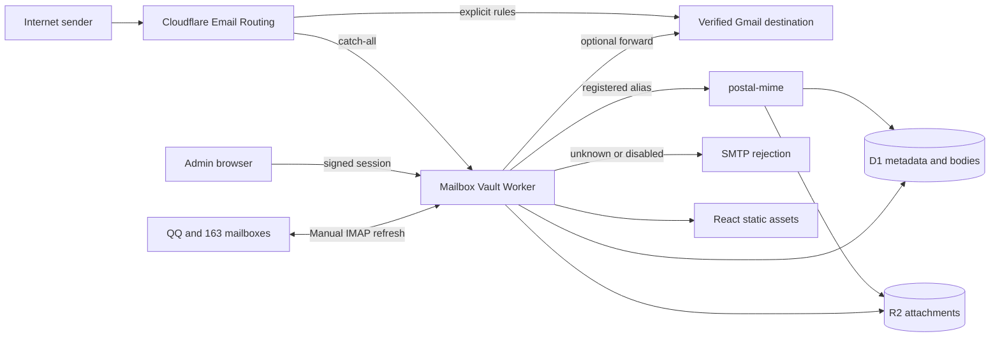

# Mailbox Vault

Mailbox Vault is a private Cloudflare-native inbox for managed aliases on `emomo.net` and connected QQ and NetEase 163 mailboxes. It stores mail metadata and text in D1 and attachments in private R2 storage.

## MVP scope

- Create custom or generated aliases under one managed domain.
- Disable and re-enable managed aliases without deleting history.
- Reject unknown or disabled catch-all recipients at SMTP time.
- Parse inbound MIME email with `postal-mime`.
- Store searchable email metadata and safe plain-text bodies in D1.
- Store and download attachments from a private R2 bucket.
- Optionally forward stored messages to one verified Email Routing destination.
- Protect every data API with a signed, HTTP-only admin session.
- Keep existing explicit Cloudflare forwarding rules separate from managed catch-all aliases.

This project provisions routing aliases, not login-capable IMAP/SMTP mailboxes, and does not automate third-party account registration.

## Connected mailboxes

1. In QQ Mail or NetEase 163, enable IMAP and generate a client authorization code.
2. In Mailbox Vault, open **收件箱 → 接入邮箱** and enter the address and authorization code. QQ Mail, Foxmail and consumer 163 accounts are supported.
3. Click **一键刷新** to fetch mail for all connected accounts. The **全部邮箱** filter includes connected accounts and managed aliases. Account errors appear individually and the account's **更新授权码** action preserves its imported mail.

The initial sync imports up to the 25 newest INBOX messages per account. Subsequent refreshes import up to 25 new messages per account at a time. Messages larger than 10 MiB are reported and remain in the source mailbox. The app imports the initial read flag and tracks subsequent read changes locally. IMAP PEEK preserves flags and message contents in the source mailbox.

The IMAP connection uses fixed TLS endpoints and encrypted authorization codes. Generate a separate 32-byte base64 key with `openssl rand -base64 32` and set it as `MAIL_ACCOUNT_KEY` in `.dev.vars` for local development or as a Worker secret when deploying. Keep the key stable across deployments to retain access to existing encrypted authorization codes. Apply the D1 migrations before starting the app or deploying the updated Worker.

The unified inbox follows [Zero](https://github.com/Mail-0/Zero/blob/4b642df/apps/server/src/trpc/routes/mail.ts#L224). IMAP uses [ImapFlow](https://github.com/postalsys/imapflow). The NetEase-specific post-login `ID` follows [Mailspring-Sync's compatibility fix](https://github.com/Foundry376/Mailspring-Sync/pull/121).

## Architecture



## Development

Requirements: Node.js 22.12 or newer and Wrangler 4.

```bash
npm install
cp .dev.vars.example .dev.vars
npm run db:migrate:local
npm run dev
```

Open `http://localhost:8787`. The production build is served by Wrangler, so the UI and Worker API run through the same origin.

Run the full verification suite:

```bash
npm run check
```

Test the local email handler with an RFC 5322 message:

```bash
curl --request POST 'http://localhost:8787/cdn-cgi/handler/email' \
  --url-query 'from=sender@example.com' \
  --url-query 'to=registered-alias@emomo.net' \
  --data-binary @message.eml
```

## Production resources

The checked-in Wrangler configuration binds these isolated resources:

| Resource | Name |
| --- | --- |
| Worker | `mailbox-vault` |
| Custom domain | `mailbox.timmyagentic.si` |
| D1 | `mailbox-vault` |
| R2 | `mailbox-vault-attachments` |
| Inbound domain | `emomo.net` |

Production secrets are set with Wrangler and are never committed:

```bash
npx wrangler secret put ADMIN_PASSWORD
npx wrangler secret put SESSION_SECRET
npx wrangler secret put MAIL_ACCOUNT_KEY
```

Apply migrations and deploy:

```bash
npm run db:migrate:remote
npm run deploy
```

After deployment, point the `emomo.net` Email Routing catch-all rule at the `mailbox-vault` Worker. Explicit aliases such as existing Gmail forwarding rules continue to take precedence.

## Security model

- `workers.dev` and preview URLs are disabled; the app is served only on its custom domain.
- API sessions are HMAC signed, expire after 24 hours, and use `HttpOnly`, `SameSite=Strict` cookies.
- State-changing requests enforce same-origin browser requests and JSON content types.
- Email HTML is stored for provenance but never rendered in the admin UI; the UI displays plain text only.
- Attachments are private R2 objects and can only be downloaded through an authenticated API route.
- CSP, frame denial, MIME sniffing protection, referrer policy, and restricted browser permissions are set on every response.
- Unknown aliases are rejected instead of becoming an open catch-all inbox.

## Device certificate login

The login page accepts the administrator password or a registered mTLS client certificate. To use an existing Cloudflare-issued device certificate, enable incoming mTLS for the Vault hostname in the same Cloudflare account and set `ADMIN_CERT_FINGERPRINTS` to its SHA-256 fingerprint. Use commas to register multiple device certificates. The password path uses the existing per-application settings.

On the HTTPS login page, select the device certificate in your browser, then click **使用设备证书登录**. Certificate sessions require the same valid, registered certificate on subsequent requests. The Worker checks the client identity reported by Cloudflare; the fingerprint is a configuration value derived from the public certificate.

[Cloudflare incoming mTLS](https://developers.cloudflare.com/ssl/client-certificates/) · [Worker certificate attributes](https://developers.cloudflare.com/ssl/client-certificates/client-certificate-variables/)

## Diagnostics

See [Operational diagnostics](docs/diagnostics.md) for event fields, error IDs, log access, and privacy boundaries. Application logs use the existing Cloudflare Workers Logs configuration.

## Source references

- [Cloudflare Email Worker handler](https://developers.cloudflare.com/email-service/api/route-emails/email-handler/)
- [Email routing rules and addresses](https://developers.cloudflare.com/email-service/configuration/email-routing-addresses/)
- [D1 Workers binding API](https://developers.cloudflare.com/d1/worker-api/)
- [R2 Workers API](https://developers.cloudflare.com/r2/api/workers/workers-api-reference/)
- [Workers static assets](https://developers.cloudflare.com/workers/static-assets/binding/)
