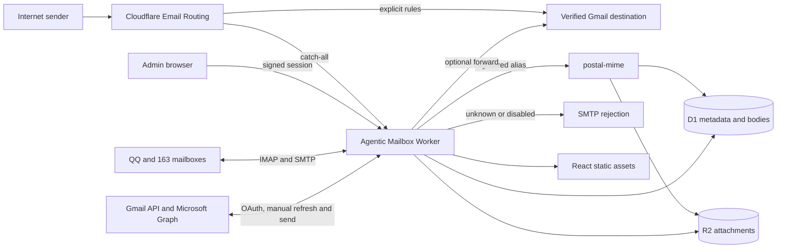

# Agentic Mailbox

Agentic Mailbox is a private Cloudflare-native inbox for managed aliases on `emomo.net` and connected QQ, NetEase 163, Gmail and Outlook mailboxes. It stores mail metadata and text in D1 and attachments in private R2 storage.

## Run locally

On Apple Silicon macOS, unzip the Mac ZIP from [GitHub Releases](https://github.com/timmyagentic/agentic-mailbox/releases) or the hosted login page and double-click **打开本地邮箱.command**. The package contains Node, workerd and the built application. It listens on loopback and opens your browser with a single-use local login. Keep the Terminal window open while using it. The package is distributed as a command-line launcher without Apple notarization.

For a source checkout, install Node 22.12 or newer, run `npm ci`, then `npm start`. The default URL is `http://127.0.0.1:8787`. Stop with Ctrl+C. Set `AGENTIC_MAILBOX_DATA_DIR` and `AGENTIC_MAILBOX_LOCAL_PORT` to customize storage and port. On macOS data persists in `~/Library/Application Support/Agentic Mailbox`. Upgrades reuse the previous edition’s data directory if it already exists. Back up the active data directory including `identity.json`, which contains the login password and encryption key. Restore it with the application stopped.

Gmail can connect using an account's 16-character app password when Google offers that option. QQ/Foxmail and 163 use their own client authorization codes. To use personal OAuth clients, run **配置本机 OAuth.command** on macOS, or set the corresponding client ID and secret pairs in `oauth.json` in the local data directory. Register `http://127.0.0.1:8787/api/oauth/gmail/callback` and/or `http://127.0.0.1:8787/api/oauth/outlook/callback` with your own provider apps. Restart after changes. The local runtime has no cloud storage, forwarding, Workers AI or managed domain sending bindings.

### Signed Mac disk image

The Apple Silicon DMG wraps the local ZIP in an app bundle with a Finder launcher. Build the ZIP first, then run `scripts/package-dmg.sh` with `AGENTIC_MAC_SIGN_IDENTITY` set to your Developer ID Application identity. Set `AGENTIC_MAC_NOTARY_PROFILE` to a local `notarytool` Keychain profile to notarize and staple the DMG. Output is written under `outputs/`. Drag the app to Applications and open it to start the same loopback mailbox with the existing local data.

## Mobile app

The [React Native app](mobile/README.md) connects to a hosted Agentic Mailbox Worker. It shares the inbox, account, draft and send APIs with the web client.

## Hosted accounts

Register a username and password on the hosted site to create a private mailbox space. Each member has a SQLite Durable Object, a distinct R2 object prefix, and independently authorized external accounts. Choose a unique password and save it in your password manager. The original administrator workspace uses its existing password or device certificate and retains the managed domain, delivery rules and D1 data. Hosted provider credentials are provisioned once by the site operator. Availability still depends on provider consent policies and API enablement.

Build the Mac distribution from this repository on Apple Silicon using `npm run build`, `npx wrangler deploy --dry-run --outdir .wrangler/local-worker` and `node scripts/package-mac.mjs`. The archive contains only the allowlisted runtime files and dependencies. The hosted download reads the fixed R2 key `releases/agentic-mailbox-mac-arm64.zip`.

## MVP scope

- Create custom or generated aliases under one managed domain.
- Disable and re-enable managed aliases without deleting history.
- Reject unknown or disabled catch-all recipients at SMTP time.
- Parse inbound MIME email with `postal-mime`.
- Store searchable email metadata and safe plain-text bodies in D1.
- Store and download attachments from a private R2 bucket.
- Optionally forward stored messages to one verified Email Routing destination.
- Protect every data API with a signed, HTTP-only admin session.
- Keep existing explicit Cloudflare forwarding rules separate from managed catch-all aliases.

This project provisions routing aliases, not login-capable IMAP/SMTP mailboxes, and does not automate third-party account registration.

## Connected mailboxes

1. In QQ Mail or NetEase 163, enable IMAP and generate a client authorization code.
2. In Agentic Mailbox, open **邮箱设置 → 接入邮箱**, choose QQ or NetEase 163, and enter the address and authorization code. QQ Mail, Foxmail and consumer 163 accounts are supported.
3. Click **一键刷新** to fetch mail for all connected accounts. The **全部邮箱** filter includes connected accounts and managed aliases. Account errors appear individually and the account's **更新授权码** action preserves its imported mail.

QQ, 163 and Gmail initially import up to 25 recent inbox messages. Outlook starts with the last 30 days of its inbox. Each manual refresh can import up to 25 messages per account. The account status shows when another refresh is needed. Messages larger than 10 MiB are reported and remain in the source mailbox. The app imports the initial read flag and tracks subsequent read changes locally. IMAP PEEK preserves flags and message contents in the source mailbox.

The IMAP connection uses fixed TLS endpoints and encrypted authorization codes. Generate a separate 32-byte base64 key with `openssl rand -base64 32` and set it as `MAIL_ACCOUNT_KEY` in `.dev.vars` for local development or as a Worker secret when deploying. Keep the key stable across deployments to retain access to existing encrypted authorization codes. Apply the D1 migrations before starting the app or deploying the updated Worker.

The unified inbox follows [Zero](https://github.com/Mail-0/Zero/blob/4b642df/apps/server/src/trpc/routes/mail.ts#L224). IMAP uses [ImapFlow](https://github.com/postalsys/imapflow). The NetEase-specific post-login `ID` follows [Mailspring-Sync's compatibility fix](https://github.com/Foundry376/Mailspring-Sync/pull/121).

### Gmail and Outlook OAuth

In **邮箱设置 → 接入邮箱**, choose Gmail or Outlook, then approve access on the provider's consent screen. Agentic Mailbox attempts the first sync after the redirect and shows its result. A saved connection can retry sync after an error. Use **重新授权** to renew a connection while keeping its stored mail.

### Provider setup for maintainers

For a self-hosted instance:

- Set `MAIL_OAUTH_ORIGIN` to the exact Vault origin, such as `http://localhost:8787` or `https://mailbox.timmyagentic.si`.
- Create a Google OAuth **Web application** client, enable the Gmail API, and register `<origin>/api/oauth/gmail/callback`. Configure the consent screen for `gmail.readonly` and `gmail.send`. If using Google’s External Testing mode, add the mailbox as a test user. For Gmail scopes issued in that mode, Google refresh tokens normally expire after seven days.
- Create a Microsoft Entra **Web** application and register `<origin>/api/oauth/outlook/callback`. Select both organizational and personal Microsoft accounts for the `common` authority. Configure delegated Microsoft Graph permissions `User.Read`, `Mail.Read` and `Mail.Send`. Organizational accounts may require administrator consent.
- Set `GMAIL_CLIENT_ID`, `GMAIL_CLIENT_SECRET`, `OUTLOOK_CLIENT_ID` and `OUTLOOK_CLIENT_SECRET` as Worker secrets in production or in `.dev.vars` locally. Use the existing `MAIL_ACCOUNT_KEY` to encrypt the tokens. Apply migration `0004_oauth_accounts.sql` before starting the new Worker build.

The Worker uses Gmail history and Microsoft Graph inbox delta cursors to import new inbox messages. On expiry it backfills from around the last completed sync. Outlook’s initial window and backfill are limited to the [filtered Graph delta query limit](https://learn.microsoft.com/en-us/graph/delta-query-messages#use-query-parameters-in-a-delta-query-for-messages). Read flags, archive and trash changes made in Vault are local. An OAuth callback finishes only with the same authenticated Vault session that started it. Worker invocation URL logging is disabled so callback codes stay out of those logs.

See [Zero’s Google driver](https://github.com/Mail-0/Zero/blob/4b642df/apps/server/src/lib/driver/google.ts), [Zero’s Outlook driver](https://github.com/Mail-0/Zero/blob/4b642df/apps/server/src/lib/driver/microsoft.ts), [Google OAuth setup](https://developers.google.com/identity/protocols/oauth2/web-server) and [Microsoft app registration](https://learn.microsoft.com/en-us/entra/identity-platform/quickstart-register-app).

## Conversation workspace

The workbench keeps the unified Inbox and account filter, with Sent, Drafts, Archive, and Trash views. It groups messages within one connected address using their message IDs and reply references. The reader shows the most recent 50 messages in a conversation. Folder, star, and read changes are stored by Agentic Mailbox.

Compose, reply, and forward from an enabled address. QQ and 163 send through their TLS SMTP servers on port 465 using the existing client authorization code. Gmail and Outlook send through their official mail APIs with the connected account’s delegated permission. Managed aliases send through the Worker `EMAIL` binding once the domain has been onboarded to Cloudflare Email Sending. Replies pass threading headers and forwards can include the source attachments. All attachments in a message share a 5 MiB limit. Outlook also caps the encoded message at 4 MB, including the base64 expansion, body and headers. Send attempts with an uncertain result leave the draft locked for review.

Open the Agent panel to generate a draft on demand. The `AI` binding uses Workers AI Gemma 4. Generation uses the current prompt, draft text and a limited excerpt of the selected conversation. Review or edit the resulting draft before pressing Send.

The workbench adapts the Apache-2.0 source layout, components and styles of [Cloudflare Agentic Inbox, 48039bb](https://github.com/cloudflare/agentic-inbox/tree/48039bb6785af34e592c2966f87cde2b255c4c80). Adapted files preserve attribution. See [LICENSE.agentic-inbox](LICENSE.agentic-inbox).

## Architecture



## Development

Requirements: Node.js 22.12 or newer and Wrangler 4.

```bash
npm install
cp .dev.vars.example .dev.vars
npm run db:migrate:local
npm run dev
```

Open `http://localhost:8787`. The production build is served by Wrangler, so the UI and Worker API run through the same origin.

Run the full verification suite:

```bash
npm run check
```

Test the local email handler with an RFC 5322 message:

```bash
curl --request POST 'http://localhost:8787/cdn-cgi/handler/email' \
  --url-query 'from=sender@example.com' \
  --url-query 'to=registered-alias@emomo.net' \
  --data-binary @message.eml
```

## GitHub Releases

Push a version tag such as `v0.1.0` or `v0.1.0-beta.1` on a commit in main. [GitHub Actions](https://github.com/timmyagentic/agentic-mailbox/actions/workflows/ci.yml) runs the full checks, builds and launches the packaged Apple Silicon edition, then publishes `agentic-mailbox-mac-arm64.zip` and `SHA256SUMS` to [GitHub Releases](https://github.com/timmyagentic/agentic-mailbox/releases). Tags with a prerelease suffix create prereleases. The hosted Worker and its R2 download are deployed separately.

## Production resources

The checked-in Wrangler configuration binds these isolated resources:

| Resource | Name |
| --- | --- |
| Worker | `agentic-mailbox` |
| Custom domain | `mailbox.timmyagentic.si` |
| D1 | `mailbox-vault` |
| R2 | `mailbox-vault-attachments` |
| Inbound domain | `emomo.net` |

Production secrets are set with Wrangler and are never committed:

```bash
npx wrangler secret put ADMIN_PASSWORD
npx wrangler secret put SESSION_SECRET
npx wrangler secret put MAIL_ACCOUNT_KEY
```

Apply migrations and deploy:

```bash
npm run db:migrate:remote
npm run deploy
```

After deployment, point the `emomo.net` Email Routing catch-all rule at the `agentic-mailbox` Worker. Explicit aliases such as existing Gmail forwarding rules continue to take precedence.

## Security model

- `workers.dev` and preview URLs are disabled; the app is served only on its custom domain.
- API sessions are HMAC signed, expire after 24 hours, and use `HttpOnly`, `SameSite=Strict` cookies.
- State-changing requests enforce same-origin browser requests and JSON content types.
- The reader sanitizes email HTML before rendering. Remote images, scripts and embedded content are stripped.
- Attachments are private R2 objects and can only be downloaded through an authenticated API route.
- CSP, frame denial, MIME sniffing protection, referrer policy, and restricted browser permissions are set on every response.
- Unknown aliases are rejected instead of becoming an open catch-all inbox.

## Device certificate login

The login page accepts the administrator password or a registered mTLS client certificate. To use an existing Cloudflare-issued device certificate, enable incoming mTLS for the Vault hostname in the same Cloudflare account and set `ADMIN_CERT_FINGERPRINTS` to its SHA-256 fingerprint. Use commas to register multiple device certificates. The password path uses the existing per-application settings.

On the HTTPS login page, select the device certificate in your browser, then click **使用设备证书登录**. Certificate sessions require the same valid, registered certificate on subsequent requests. The Worker checks the client identity reported by Cloudflare; the fingerprint is a configuration value derived from the public certificate.

[Cloudflare incoming mTLS](https://developers.cloudflare.com/ssl/client-certificates/) · [Worker certificate attributes](https://developers.cloudflare.com/ssl/client-certificates/client-certificate-variables/)

## Diagnostics

See [Operational diagnostics](docs/diagnostics.md) for event fields, error IDs, log access, and privacy boundaries. Application logs use the existing Cloudflare Workers Logs configuration.

## Source references

- [Cloudflare Email Worker handler](https://developers.cloudflare.com/email-service/api/route-emails/email-handler/)
- [Email routing rules and addresses](https://developers.cloudflare.com/email-service/configuration/email-routing-addresses/)
- [D1 Workers binding API](https://developers.cloudflare.com/d1/worker-api/)
- [R2 Workers API](https://developers.cloudflare.com/r2/api/workers/workers-api-reference/)
- [Workers static assets](https://developers.cloudflare.com/workers/static-assets/binding/)
