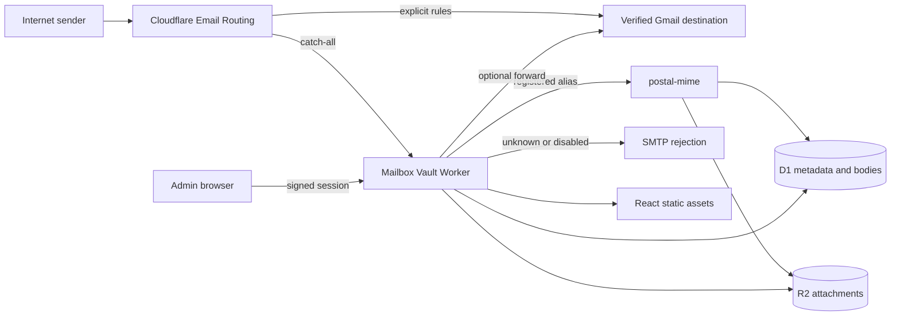

# Mailbox Vault

Mailbox Vault is a private Cloudflare-native inbox for managed aliases on `emomo.net`. It creates and disables aliases, stores incoming mail metadata and text in D1, stores attachments in R2, and exposes a responsive admin interface at `mailbox.timmyagentic.si`.

## MVP scope

- Create custom or generated aliases under one managed domain.
- Disable and re-enable managed aliases without deleting history.
- Reject unknown or disabled catch-all recipients at SMTP time.
- Parse inbound MIME email with `postal-mime`.
- Store searchable email metadata and safe plain-text bodies in D1.
- Store and download attachments from a private R2 bucket.
- Optionally forward stored messages to one verified Email Routing destination.
- Protect every data API with a signed, HTTP-only admin session.
- Keep existing explicit Cloudflare forwarding rules separate from managed catch-all aliases.

This project provisions routing aliases, not login-capable IMAP/SMTP mailboxes, and does not automate third-party account registration.

## Architecture



## Development

Requirements: Node.js 22.12 or newer and Wrangler 4.

```bash
npm install
cp .dev.vars.example .dev.vars
npm run db:migrate:local
npm run dev
```

Open `http://localhost:8787`. The production build is served by Wrangler, so the UI and Worker API run through the same origin.

Run the full verification suite:

```bash
npm run check
```

Test the local email handler with an RFC 5322 message:

```bash
curl --request POST 'http://localhost:8787/cdn-cgi/handler/email' \
  --url-query 'from=sender@example.com' \
  --url-query 'to=registered-alias@emomo.net' \
  --data-binary @message.eml
```

## Production resources

The checked-in Wrangler configuration binds these isolated resources:

| Resource | Name |
| --- | --- |
| Worker | `mailbox-vault` |
| Custom domain | `mailbox.timmyagentic.si` |
| D1 | `mailbox-vault` |
| R2 | `mailbox-vault-attachments` |
| Inbound domain | `emomo.net` |

Production secrets are set with Wrangler and are never committed:

```bash
npx wrangler secret put ADMIN_PASSWORD
npx wrangler secret put SESSION_SECRET
```

Apply migrations and deploy:

```bash
npm run db:migrate:remote
npm run deploy
```

After deployment, point the `emomo.net` Email Routing catch-all rule at the `mailbox-vault` Worker. Explicit aliases such as existing Gmail forwarding rules continue to take precedence.

## Security model

- `workers.dev` and preview URLs are disabled; the app is served only on its custom domain.
- API sessions are HMAC signed, expire after 24 hours, and use `HttpOnly`, `SameSite=Strict` cookies.
- State-changing requests enforce same-origin browser requests and JSON content types.
- Email HTML is stored for provenance but never rendered in the admin UI; the UI displays plain text only.
- Attachments are private R2 objects and can only be downloaded through an authenticated API route.
- CSP, frame denial, MIME sniffing protection, referrer policy, and restricted browser permissions are set on every response.
- Unknown aliases are rejected instead of becoming an open catch-all inbox.

## Diagnostics

See [Operational diagnostics](docs/diagnostics.md) for event fields, error IDs, log access, and privacy boundaries. Application logs use the existing Cloudflare Workers Logs configuration.

## Source references

- [Cloudflare Email Worker handler](https://developers.cloudflare.com/email-service/api/route-emails/email-handler/)
- [Email routing rules and addresses](https://developers.cloudflare.com/email-service/configuration/email-routing-addresses/)
- [D1 Workers binding API](https://developers.cloudflare.com/d1/worker-api/)
- [R2 Workers API](https://developers.cloudflare.com/r2/api/workers/workers-api-reference/)
- [Workers static assets](https://developers.cloudflare.com/workers/static-assets/binding/)
